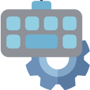

<a href="https://www.flaticon.com/free-icons/computer-hardware" title="computer hardware icons">Computer hardware icons created by Rian Maulana - Flaticon (CC-BY-SA 4.0)</a>
<a href="https://www.flaticon.com/free-icons/settings" title="settings icons">Settings icons created by Freepik - Flaticon (CC-BY-SA 4.0)</a>

# Keeb Utils

Keeb Utils (“Keyboard Utilities”) is a modular suite of keyboard layouts and layer configurations designed to improve typing ergonomics and productivity. It provides cross-platform configurations for the Flint alternative keyboard layout and traditional QWERTY, with functional layers inspired by work from the alternative keyboard layout community.

## Design principles

Keeb Utils follows these core principles:

- **Functionality and minimalism:** Favors reliable, essential tools over high-maintenance features.
- **Cross-platform parity:** Keeps behavior consistent across software implementations.
- **Modularity:** Makes components easy to customize and replace.

## Supported platforms

Keeb Utils uses third-party software to remap keys at the operating system level:

- **Linux:** [KMonad](https://github.com/kmonad/kmonad)
- **Windows:** [AutoHotkey v2](https://www.autohotkey.com/)

## Keyboard layout

This project includes Flint, a custom keyboard layout designed for English, Polish, and Hungarian. It aims to promote hand alternation, reduce finger fatigue, and minimize same-finger bigrams.

*Further reading:*

- Learn more about Flint: [Flint Keyboard Layout](Docs/Flint%20Keyboard%20Layout.md)

*Flint keymap for ANSI 101/104-key keyboards*

## Functional layers

Keeb Utils uses layers to provide access to navigation, symbols, and numeric entry without requiring significant hand movement.

### Extend layer

The Extend layer supports text editing and navigation. Hold <kbd>Caps Lock</kbd> to activate it and access essential functions from the home row.

**Key benefits:**

- **Home row retention:** Keeps your hands in the primary typing position to help reduce wrist fatigue.
- **Optimized navigation:** Maps arrow keys to <kbd>U</kbd>, <kbd>H</kbd>, <kbd>E</kbd>, and <kbd>A</kbd> (QWERTY <kbd>I</kbd>, <kbd>J</kbd>, <kbd>K</kbd>, and <kbd>L</kbd>).
- **Integrated shortcuts:** Provides common actions through home-row modifiers, such as *select next word* (<kbd>Ctrl+Shift+Right</kbd>), *switch to next tab* (<kbd>Ctrl+Tab</kbd>), and *go to previous page* (<kbd>Alt+Left</kbd>).

*Extend layer keymap for ANSI 101/104-key keyboards*

| Key category | Description |
| :----------: | ----------- |
|  | Navigation keys |
|  | Common Ctrl-based shortcuts |
|  | Modifier key access |
|  | One-shot modifier (see [Advanced modifier logic](#advanced-modifier-logic)) |
|  | Multi-timed modifiers (see [Advanced modifier logic](#advanced-modifier-logic)) |
|  | Text manipulation |
|  | Multimedia keys |
|  | Function and miscellaneous keys |

#### Advanced modifier logic

**One-shot modifier** (also known as a sticky key):

- **Tap:** Applies a modifier, such as <kbd>Shift</kbd>, to the next key press. It expires after a timeout if no key is pressed.
- **Hold:** Acts like a normal modifier key.

**Multi-timed modifiers:** A rapid double tap activates a second modifier alongside the primary modifier.

**Example: using Ctrl and Shift**

- **Single tap:** Applies the primary modifier to the next key press.
- **Single tap and hold:** Holds the primary modifier.
- **Double tap:** Applies both the primary and secondary modifiers to the next key press.
- **Double tap and hold:** Holds both modifiers.

*Rationale:* KMonad does not combine multiple one-shot modifiers. This implementation allows combinations such as <kbd>Ctrl+Shift</kbd> to work across applications.

*References and inspirations:*

- Øystein “DreymaR” Bech-Aase – [Extend Extra Extreme](https://dreymar.colemak.org/layers-extend.html)
- Steve “stevep99” P – [Seniply](https://stevep99.github.io/seniply/)
- Manna Harbour – [Miryoku](https://github.com/manna-harbour/miryoku)

### Symbols layer

The Symbols layer provides ergonomic access to mathematical operators, programming symbols, and numbers. Hold <kbd>Left Alt</kbd> to activate it.

- **Balanced distribution:** Spreads numerals and symbols across both hands.
- **Logical grouping:** Groups brackets and operators to support muscle memory.

*Symbols layer keymap for ANSI 101/104-key keyboards*

| Key category | Description |
| :----------: | ----------- |
|  | Numpad keys |
|  | Programming symbols |
|  | Math operators |
|  | Symbol pairs |
|  | Miscellaneous symbols |

*References and inspirations:*

- Pascal Getreuer – [Designing a Symbol Layer](https://getreuer.info/posts/keyboards/symbol-layer/index.html)

## License and disclaimers

Code is licensed under the **MIT License**. Assets without a specified license are in the **public domain**. See `LICENSE` for the full legal text.

THE SOFTWARE IS PROVIDED "AS IS", WITHOUT WARRANTY OF ANY KIND, EXPRESS OR IMPLIED, INCLUDING BUT NOT LIMITED TO THE WARRANTIES OF MERCHANTABILITY, FITNESS FOR A PARTICULAR PURPOSE AND NONINFRINGEMENT. IN NO EVENT SHALL THE AUTHORS OR COPYRIGHT HOLDERS BE LIABLE FOR ANY CLAIM, DAMAGES OR OTHER LIABILITY, WHETHER IN AN ACTION OF CONTRACT, TORT OR OTHERWISE, ARISING FROM, OUT OF OR IN CONNECTION WITH THE SOFTWARE OR THE USE OR OTHER DEALINGS IN THE SOFTWARE.
